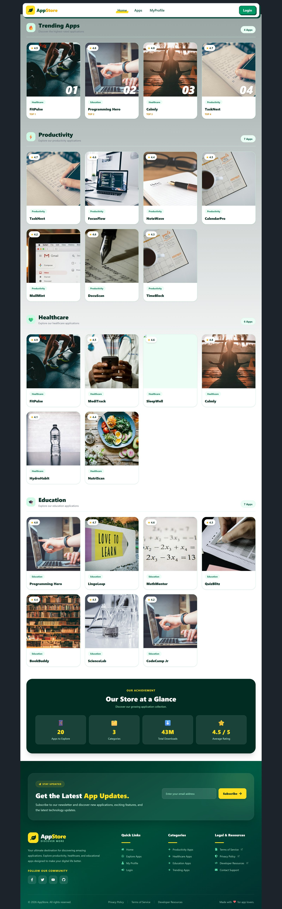
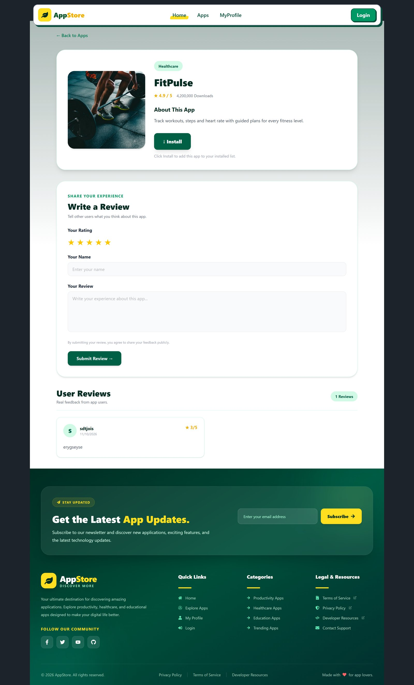
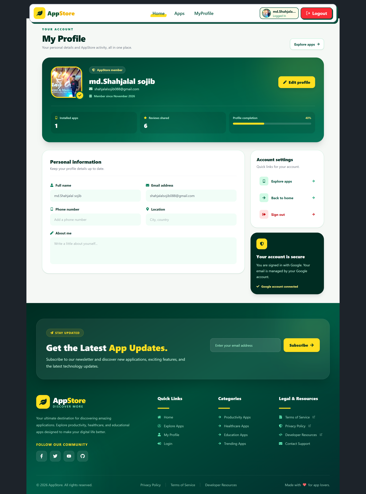

# AppStore

AppStore is a responsive app discovery site built with React and Vite. Browse applications by category, view app details, install apps locally, and leave reviews. Google sign-in powers the account and profile pages.

## Screenshots

### Home page


### App catalog



### App details and reviews



### My profile



### Signed-in navigation


## Features

- Browse trending apps and the Productivity, Healthcare, and Education categories.
- View app ratings, download counts, descriptions, and reviews.
- Save install state and reviews in the browser's local storage.
- Sign in with Google through Firebase Authentication.
- View and edit profile details. Profile edits are saved in the browser for the signed-in account.
- Responsive navigation and layouts for desktop and mobile.

## Routes

| Route | Page |
| --- | --- |
| `/` | Home and app discovery |
| `/apps` | App catalog |
| `/apps/:id` | App details and reviews |
| `/login` | Google sign-in |
| `/myprofile` or `/my-profile` | Signed-in user's profile |

## Run locally

Requirements: Node.js and npm.

```sh
npm install
npm run dev
```

Vite prints the local development URL in the terminal.

## Build

```sh
npm run build
npm run preview
```

The production site is generated in `dist/`. The build also creates `dist/200.html` for Surge single-page-app routing.

## Deploy

### Vercel

Import the GitHub repository and use the Vite preset with the project root as the root directory. The build command is `npm run build`, and the output directory is `dist`. `vercel.json` rewrites app routes to the SPA entry point so routes can be opened or refreshed directly.

### Surge

Build the project and publish the contents of `dist/`, including `200.html`.

## Firebase sign-in setup

The Firebase web configuration is in `src/Firebase/Firebase.init.js`. Enable the Google provider in Firebase Authentication, then add each deployed site's hostname under **Authentication → Settings → Authorized domains**. Enter only the hostname, without a protocol or path. Without this, Google sign-in returns `auth/unauthorized-domain`.

## Project structure

```text
src/
  Components/   Shared navigation, footer, and banner
  Firebase/     Firebase app and authentication setup
  Pages/        Home, app catalog, details, login, and profile pages
  Routes/       React Router configuration
  data/         App catalog data
```
